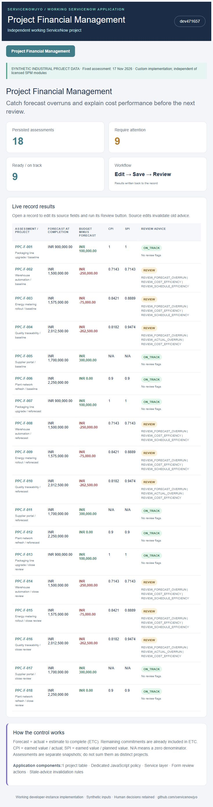

# Project Financial Management

A complete working custom ServiceNow project with editable source records, a server-side JavaScript policy, a Review form button, persisted advice, stale-advice invalidation and a live workspace. This project installs independently; neither of the other two projects is required.

Which project assessments are likely to finish over budget, and why?

## The real-world problem

On industrial capital projects (a packaging line, a warehouse automation cell), cost overruns are usually discovered at month-end close, once the money is already committed. A project manager can see *what has been spent*, but not whether the project is heading over budget *at completion*, or whether it is behind schedule as well as over cost.

This app gives a PMO a weekly early-warning list. For each project it combines actuals with the estimate to complete, works out the forecast at completion and the earned-value indices, and tells the reviewer **which** problem they are looking at, so the conversation starts with a decision instead of a spreadsheet hunt.

**Who uses it:** PMO analyst (runs Review), project manager (explains the variance), finance business partner (approves re-forecasts).

### Decision guide

| Flag | What it means | Typical next step |
|---|---|---|
| `REVIEW_FORECAST_OVERRUN` | Actual + estimate to complete exceeds budget | Re-forecast, descope, or raise a budget change request before more is committed |
| `REVIEW_ACTUAL_OVERRUN` | Money already spent exceeds budget | Freeze discretionary spend; escalate to the sponsor |
| `REVIEW_COST_EFFICIENCY` | CPI below 0.90: under 90 paise of planned work delivered per rupee spent | Check vendor rates, rework and scope creep |
| `REVIEW_SCHEDULE_EFFICIENCY` | SPI below 0.90: less work done than planned by now | Find blocked work; check resource availability |

Example: PPC-F-002 (warehouse automation) is forecast to finish INR 2.5 lakh over budget **and** has CPI and SPI of 0.71. It is both expensive and late, so it needs a recovery plan rather than just a budget top-up.

## Observed results — synthetic data

- 9 of 18 synthetic financial assessments flag a forecast overrun.
- 17/17 local policy tests passed.
- 18/18 persisted ServiceNow results matched the local expected results.
- The two installed Script Includes matched the packaged source exactly.
- Source edit → old-advice invalidation → recalculation → fixture restoration → repeat review passed on the instance.
- The real form Review button was clicked and its success message captured.

Assessment: 17 November 2026. Instance timestamps are retained as displayed by ServiceNow; they may use a different clock/time zone. Verification is implementation evidence on synthetic cases, not measured business improvement.

After installing on your own developer instance, open `https://<your-instance>.service-now.com/u_project_financial_management.do`.



## What it does

Budget, actual cost, estimate to complete, forecast at completion, budget variance, CPI and SPI.

PPC-F-002: budget INR 1,250,000; actual INR 875,000; ETC INR 625,000. Forecast = INR 1,500,000, with INR 250,000 adverse variance. CPI and SPI are both 0.7143.

Amounts are integer INR paise. Remaining commitments are a subset of ETC, so they are not added twice. Indices with zero denominators are null. Baseline values cannot exceed budget. Current ServiceNow money input columns are 32-bit integers; the synthetic values fit. These are distinct assessment scenarios for six projects, not 18 independent investments; do not add the scenarios together.

## Run locally

Requires Node.js 18 or newer. No external packages, API keys or installation required.

```sh
npm test
npm run build
```

The tests execute `servicenow/ProjectFinancePolicy.js`, the same file installed in ServiceNow. The builder regenerates expected results, source hashes, the UI Page XML and standalone installers from local files. Original CSVs and JSON data are supplied.

## ServiceNow hands-on

Read [the step-by-step guide](docs/STEP_BY_STEP.md). The working application uses Global custom table `u_ppc_financial`, Script Includes `ProjectFinancePolicy` and `ProjectFinanceService`, one Review UI Action, one before-insert/update Business Rule and UI Page `u_project_financial_management`.

The instance did not have native `pm_project`, `pm_project_task`, `cost_plan` or `resource_plan` tables. This is a custom implementation, not a claim that licensed ServiceNow SPM modules were activated. Current workflow is administrator-only; production role design, security testing, change control and operational hardening are outside this completed developer-instance implementation.

## Files

- `data/`: deterministic, invented industrial-project records; no real company or personal finances.
- `servicenow/`: policy, service, button, rule, workspace and install/verify scripts.
- `tests/`: hand-calculated cases, thresholds and invalid-input checks.
- `results/`: expected records, source hashes and actual local TAP test log.
- `evidence/`: real browser observations and three real screenshots from the separate project.
- `docs/`: instructions, dataset provenance, architecture, sources and validation limits.
- `media/`: LinkedIn infographic, alt text and caption draft.
- `PROMPT.md`: reproducible project prompt, incorporating the separate-project requirement.

Published by [servicenowjyo](https://github.com/servicenowjyo).
